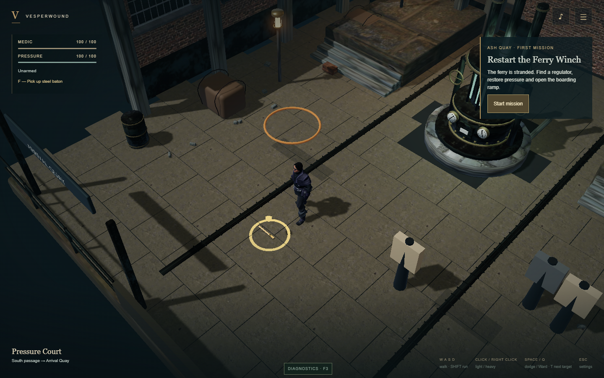

# Paving depth correction — 2026-10-14

Review fix developed on `codex/first-mission`; user approved commit, merge into
main and push on 2026-10-14.

## Confirmed cause

The retained `Wet scanned paving` base and new court flags both reached **0.04 m**
in the authored source. Meshopt quantization left only about **0.00021 m** between
their top surfaces at runtime. Depth precision at gameplay distance produced the
thin horizontal dark streaks reported by the user.

Controlled WebGPU comparisons retained the streaks with the key light's shadows
disabled, and removed them when the basalt base was hidden. This establishes
overlapping floor depth as the cause of these streaks, rather than shadow acne.

## Correction

The saved `art/source/ash-quay-district.blend` now recesses the old court base to
**0.015 m**, leaving the visible flags and collision heights intact. The decoded
desktop export has a base top at **0.01457 m** and flag tops at **0.03978 m**:
approximately **2.52 cm** of separation. Both tiers are checked for at least 2 cm
of clearance by the environment asset regression test.

`tools/blender/correct_paving_depth.py` records this explicit source edit. The
original authoring command also uses the recessed height. Normal environment
builds still export saved sources read-only, verify the source hash and regenerate
the reflection bake. Provenance records the modification. Shadows, shader settings,
combat and navigation are unchanged. Triangle/mesh/texture counts are unchanged.

## Validation

- Three diagnostic WebGPU runs: baseline, shadows disabled, base hidden.
- Three corrected traversal runs: hardware WebGPU, hardware WebGL2 and Pixel 7
  touch emulation. Each visits court, alley and quay using real controls; no page
  errors. Chrome 155.0.8059.41, desktop 1440 × 900 and mobile 915 × 412.
- Actual screenshots inspected: reported streaks are absent, while character,
  prop and architectural shadows remain.
- `npm run check` passes: TypeScript, lint, 96 tests and production build.
  The initial sandbox run failed to read temporary transformed modules; the
  unrestricted rerun passed without code changes for those errors.
- `npm run size` passes. Initial raw art: desktop **18,999,728 bytes**, mobile
  **10,470,363 bytes**; the reflection rebake adds roughly 4.6 KiB per tier.
- Validation servers stopped; ports 5173, 5182 and 4173 verified clear.

The existing five-minute mission/inspection measurements predate this source-height
correction and have not been rerun. No extra draw calls, geometry, textures or
shader work were introduced. Physical-phone testing remains unverified.

## Captures

[Before](paving-webgpu-baseline-court.png) ·
[Shadows disabled: streaks remain](paving-webgpu-no-shadows-court.png) ·
[Base hidden: streaks disappear](paving-webgpu-no-base-court.png)



[Corrected WebGL2](paving-webgl2-corrected-court.png) ·
[Corrected mobile](paving-mobile-corrected-court.png) ·
[Corrected quay](paving-webgpu-corrected-quay.png)

Repeat the corrected captures with:

```sh
npx playwright test -c playwright.paving.config.ts
```
